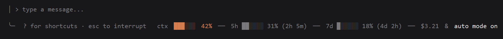

# status-band

Etiqueta junto a los modos de sesión, a la derecha del pie del prompt de Claude Code (donde aparece "auto mode on" y similares), con el estado de la sesión en una sola línea.



*(captura ilustrativa con datos inventados, para que se vea el formato — no una sesión real)*

## Qué muestra, de izquierda a derecha

| Segmento | Qué es | Color |
| --- | --- | --- |
| `ctx NN%` | % de la ventana de contexto del modelo ya usado | cambia según lo lleno: normal hasta 60%, aviso hasta 85%, crítico a partir de ahí |
| `5h ...` | % consumido de la ventana de 5 horas, y cuándo resetea | gris tenue |
| `7d ...` | % consumido de la ventana semanal (7 días), y cuándo resetea | gris tenue |
| `$N.NN` | coste acumulado de la sesión | gris tenue |
| `& <modo>` | el modo de sesión activo (p. ej. "auto mode on"), si lo hay — la etiqueta propia de Claude Code, sin tocarla | como la pinta Claude Code |

Se actualiza solo, sin tener que abrir `/status` ni `/context`.

El contexto se mide sobre la ventana del modelo; `/context` mide contra la ventana de compactación, normalmente algo menor, así que el `ctx NN%` de aquí puede ir algo adelantado respecto a lo que diga `/context`.

## Instalación

En el prompt de una sesión de Claude Code:

```
/plugin install status-band --marketplace luiscorbachoflores/claude-plugins
```

O desde una shell:

```
claude plugin install status-band --marketplace luiscorbachoflores/claude-plugins
```
